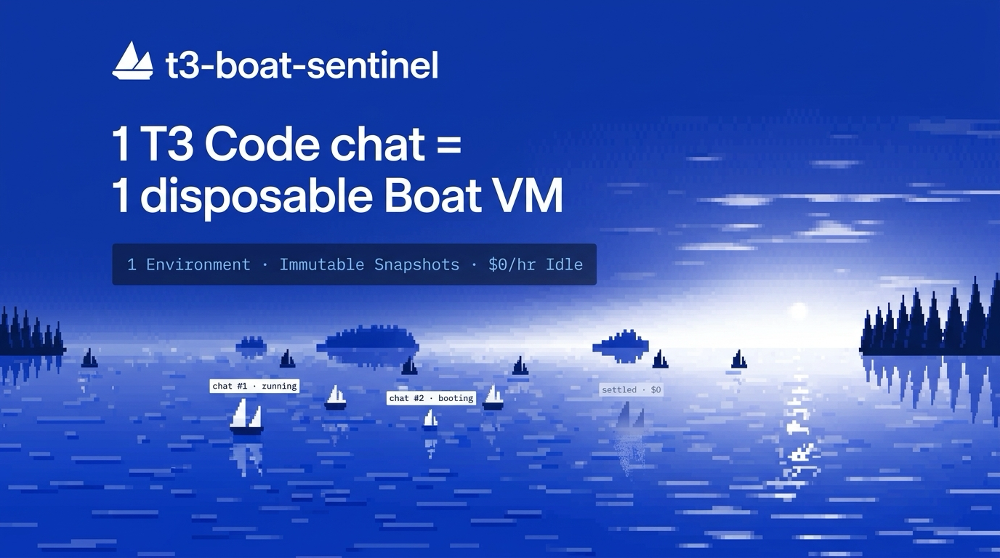
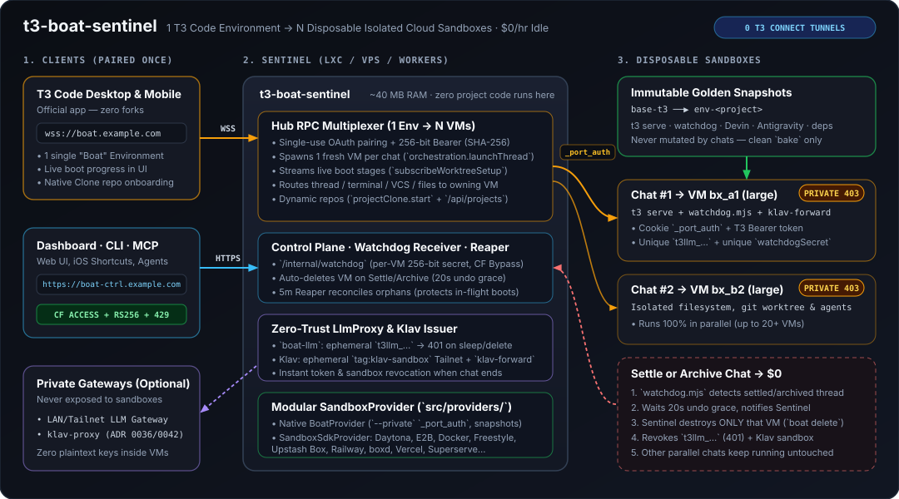

# t3-boat-sentinel



**1 chat = 1 disposable [Boat](https://boat.dev) cloud sandbox behind a single [T3 Code](https://t3.codes) Environment (Desktop & Mobile) — zero T3 forks, zero T3 Connect tunnels consumed, immutable golden snapshots, and zero-trust proxies.**

`t3-boat-sentinel` runs as a tiny always-on sentinel daemon (Proxmox LXC, Raspberry Pi, or any $4 VPS — **none of your project code runs on the sentinel**) behind a single wildcard Cloudflare Tunnel.

---

## Why this exists

| | Traditional single-VM setups | `t3-boat-sentinel` |
|---|---|---|
| **Environment UX** | Pair 1 environment per VM/slot | **1 single `Boat` Environment** — spawns up to `N` (e.g. 20) parallel Boat VMs on demand |
| **Sandbox isolation** | 1 persistent VM shared across chats | **1 chat = 1 fresh disposable VM** from an immutable golden snapshot (`env-<project>`) |
| **Golden snapshots** | Overwritten on sleep (accumulates worktrees & bloat) | **Strictly immutable** — chats never mutate snapshots; only clean `bake` updates them |
| **Settle / Archive a chat** | Keeps VM & disk around | **Auto-destroys only that chat's Boat VM ($0)** + revokes its ephemeral tokens & Klav sandbox |
| **Adding new repos** | Hand-edit YAML & restart | **Automatic** via T3 Code's native Clone UI, the web Dashboard (`+ Add GitHub Repo`), API, or MCP |
| **Live boot feedback** | Blind spinner or extra Mac CLI | **Native progress inside T3 Code UI** via `subscribeWorktreeSetup` (zero extra client install) |
| **Secrets & LLM keys** | Plaintext API keys inside VMs | **Zero-trust**: per-sandbox ephemeral `LlmProxy` tokens + optional [Klav](https://klav.dev) (`klav-proxy` + ephemeral Tailnet) |
| **T3 Connect tunnels** | Consumes 1 tunnel per VM | **0 T3 Connect tunnels** (all traffic rides your own wildcard Cloudflare Tunnel) |

---

## Architecture (Hub Mode — Recommended)



```text
T3 Code Desktop (Mac/Linux/Win) + T3 Mobile
   │  wss://boat.example.com       (paired ONCE forever — 1 Environment for all repos & chats!)
   │  https://boat-ctrl.example.com (web dashboard / MCP / API — optional Cloudflare Access)
   ▼
Sentinel host (Proxmox LXC / Docker — ~40MB RAM, zero project code runs here)
   ├── cloudflared (1 wildcard tunnel: *.example.com -> http://127.0.0.1:8080)
   ├── Hub RPC Multiplexer (`boat.example.com`)
   │     ├── Presents all configured & dynamically-added repos in ONE T3 Environment
   │     ├── Streams live VM boot progress directly into T3 UI (`subscribeWorktreeSetup`)
   │     ├── Spawns 1 fresh isolated Boat VM per new chat (`orchestration.launchThread`)
   │     ├── Rewrites projectIds & routes every thread/terminal/VCS/attachment RPC to its owning VM
   │     └── Auto-reaps each VM independently when its chat is settled or archived
   ├── Zero-Trust LLM Proxy (`boat-llm.example.com`)
   │     └── Per-VM ephemeral `t3llm_...` token valid ONLY while `phase === "running"` (401 on sleep/delete)
   └── Reaper (reconciles `boat list --all` every 5m so zero orphan VMs bill)
   ▼
Disposable Boat VMs (`boat new --type large --from env-<project>`)
   ├── t3code.service (official `t3 serve`, auto-pinned to your Desktop/Mobile version)
   ├── Optional Klav ephemeral sandbox (`klav-forward` over `tag:klav-sandbox` Tailnet — real API keys never enter VM)
   └── watchdog.mjs (0 npm deps)
         ├── Chat settled / archived -> notifies sentinel -> destroys ONLY that VM ($0) + revokes tokens
         └── Idle (no agents, no CPU builds) -> pauses VM (never mutates golden snapshots)
```

*(Classic fixed-slot mode `boat-1..N` is also still supported if you want dedicated named environments per slot.)*

---

## Features

- **1-Environment Hub Multiplexer (`hub:`):** Pair `https://boat.example.com` **once** on T3 Desktop and **once** on T3 Mobile. Every new chat automatically spawns its own isolated Boat VM (`defaultSize: large` / `default` / `medium`, configurable globally or per-project), runs completely in parallel (up to `hub.maxSandboxes`), and is destroyed independently when you **Settle** or **Archive** the thread.
- **Zero-YAML Repo Onboarding:** Add new repositories without touching `sentinel.yaml`:
  1. Directly in **T3 Code UI** (Clone repository → Hub intercepts `projectClone.start`, registers the repo, and bakes `env-<repo>` in the background with live clone progress!).
  2. From the **Dashboard** (`https://boat-ctrl.example.com` → `+ Add GitHub Repo` → enter `owner/repo`).
  3. Via **REST API** (`POST /api/projects`) or **MCP** (`sentinel_add_project`).
  If you start a chat before `env-<repo>` finishes baking, Sentinel automatically boots from `base-t3` and clones on first boot.
- **Native Live Boot Progress in T3 Code:** Streams real-time VM creation, Klav setup, T3 server startup, and connection stages straight into T3 Code's native setup progress panel (`subscribeWorktreeSetup`) — no separate Mac CLI required.
- **Immutable 2-Tier Golden Snapshots:** `base-t3` (Ubuntu + `t3` + watchdog + cached provider/ACP tool binaries + optional `klav-forward`) → `env-<project>` (always built cleanly from `base-t3`, smoke-tested, and wiped of per-VM DB/tokens while preserving pre-cached provider binaries). Supports daily UTC auto-bake (`baseBakeHourUtc` / `bakeHourUtc`).
- **Provider Sign-ins That Follow You (`t3.persistProviderSessions`):** Sign in to Antigravity once in any Hub chat and every later chat VM starts signed in. Sentinel captures the credential file from the signed-in VM into `<stateDir>/credentials/<instanceId>/` (dir 0700, file 0600, atomic, newer `expiry` wins), copies it into each new VM before T3 starts, pulls the CLI's refreshed copy before a VM is destroyed, and never bakes it into a snapshot. Signing out in T3 (or `sentinel forget-session antigravity`) deletes the stored copy. Setup steps: [Devin and Antigravity](#devin-and-antigravity).
- **Zero-Trust LLM Proxy (`llmProxy:`):** Forward Claude/OpenAI requests to a private LAN/Tailscale gateway (e.g., `cliproxy`) without ever letting Boat VMs join your LAN or see your real API key. Each running VM receives a unique `t3llm_...` token that immediately returns `401` the moment the VM sleeps or is destroyed.
- **Zero-Knowledge Secrets with [Klav](https://klav.dev) (`klav:`):** Supports Klav ADR 0036/0042 (`mode: proxy` with `klav-proxy` + ephemeral `tag:klav-sandbox` Tailscale + `klav-forward`) so agents can call external APIs (e.g. Northflank, GitHub, Cloudflare) without plaintext secrets ever entering the sandbox, revoking access automatically when the chat ends.
- **Auto-Delete on Settle or Archive:** Configure `deleteWhen: archived-or-settled` (or `archived`) and `archiveAction: delete` (or `stop`). After `archiveGraceSecs` (default 20s), the VM is permanently deleted ($0/hr idle, no standby pool required).
- **Modular Sandbox Providers (`src/providers/`):** Built around a capability-gated `SandboxProvider` contract inspired by [`@opencoredev/sandbox-sdk`](https://sandbox-sdk.app/docs) (`pause`, `snapshots`, `private-preview` with `{ url, headers }`). Ships with native `BoatProvider` by default AND a drop-in `SandboxSdkProvider` adapter so Daytona, E2B, Docker, Vercel Sandbox, Upstash Box, Railway, Freestyle, or `boxd` can plug in via `provider:` in `sentinel.yaml`.
- **Link Security Hardening (`src/security.ts`):** Built-in sliding-window auth rate limiting (`429` on `/oauth/token` and API brute force), optional zero-dependency origin-side **Cloudflare Access RS256 JWT verification** (`security.cloudflareAccess`), `robots.txt` + `X-Robots-Tag: noindex`, strict CSP & `X-Frame-Options: DENY` on the Dashboard, and `boat.hostVisibility: private` support for cookie/token-gated upstream VM URLs.
- **Built-in stdio MCP Server + Agent Skill:** Run `bun run sentinel mcp` and install [`skills/t3-boat-sentinel/SKILL.md`](skills/t3-boat-sentinel/SKILL.md) so personal assistants and coding agents can check status, add repos, bake snapshots, and manage sandboxes.

---

## Quickstart

### Fastest Path: Let Your Coding Agent Deploy It (Recommended)

Don't wire tunnels, DNS, snapshots, and Cloudflare Access by hand — paste this into **Claude Code / T3 Code / Codex / Antigravity**:

```text
Read https://github.com/OmarAlex24/t3-boat-sentinel/blob/main/docs/AGENT-DEPLOY.md and deploy t3-boat-sentinel for me.
Ask me first whether I want self-hosted (Proxmox LXC / VPS / Docker) or serverless on Cloudflare Workers (no VPS required), then configure everything and verify end-to-end.
```

See [**`docs/AGENT-DEPLOY.md`**](docs/AGENT-DEPLOY.md) for the full agent runbook (both self-hosted and **No-VPS Cloudflare Workers + Durable Objects**).

### Option A: Proxmox LXC / Linux host (recommended, ~512MB RAM, $0 extra)

```bash
git clone https://github.com/OmarAlex24/t3-boat-sentinel /opt/t3-boat-sentinel
cd /opt/t3-boat-sentinel
bash scripts/install-lxc.sh

# 1. Authenticate Boat CLI once
boat onboard

# 2. Generate sentinel.yaml with a cryptographic controlSecret
bun run sentinel init
$EDITOR sentinel.yaml

# 3. Point a single Cloudflare Tunnel wildcard to http://127.0.0.1:8080:
#      *.example.com -> http://127.0.0.1:8080
#
#    Security note:
#    - Do NOT put Cloudflare Access on `boat.example.com` or `boat-llm.example.com`
#      (they use T3's OAuth/Bearer auth and per-VM ephemeral tokens).
#    - DO protect `boat-ctrl.example.com` with Cloudflare Access (Email OTP / GitHub),
#      and add ONE Bypass application for `boat-ctrl.example.com/internal/watchdog`
#      so Boat VMs can deliver per-sandbox signed watchdog events.

# 4. Start the daemon
sudo systemctl start t3-boat-sentinel
```

### Option B: Docker Compose

```bash
cp sentinel.example.yaml sentinel.yaml
# Set CONTROL_SECRET (and optional LLM_UPSTREAM_API_KEY / CLOUDFLARE_TUNNEL_TOKEN) in .env
docker compose run --rm sentinel boat onboard
docker compose up -d
# Or with bundled cloudflared sidecar:
docker compose --profile tunnel up -d
```

### Option C: No VPS? Deploy on Cloudflare Workers + Durable Objects ($5/mo Workers Paid)

If you don't have a homelab or VPS, Sentinel's core (`HubServer`, `ControlPlane`, `src/security.ts`, and `SandboxSdkProvider`) is built on Web Standard APIs (`fetch`, `WebSocket`, `crypto.subtle`) and can run serverless on **Cloudflare Workers + Durable Objects** using an HTTP sandbox provider (`@opencoredev/sandbox-sdk` with Daytona, E2B, Freestyle, Upstash Box, Railway, boxd, or Boat's HTTP API).

Follow the agent-ready blueprint in [**`docs/AGENT-DEPLOY.md`**](docs/AGENT-DEPLOY.md#path-b-agent-blueprint--serverless-on-cloudflare-workers-no-vps-required) (your coding agent can scaffold & deploy it for you).

---

## First-Time Setup

1. **Bake your immutable base snapshot (`base-t3`):**
   ```bash
   bun run sentinel bake base
   ```

2. **Add & bake your first project (either in `sentinel.yaml` or directly from the Dashboard / API):**
   ```bash
   bun run sentinel bake my-app
   ```
   Or dynamically without touching YAML:
   ```bash
   curl -X POST https://boat-ctrl.example.com/api/projects \
     -H "Authorization: Bearer $CONTROL_SECRET" \
     -H "Content-Type: application/json" \
     -d '{"repo": "owner/my-app", "bake": true}'
   ```

3. **Pair your Hub ONCE in T3 Desktop and ONCE in T3 Mobile:**
   ```bash
   bun run sentinel pair hub
   ```
   Paste the link in **T3 Code → Settings → Environments → Add environment**.
   *(Generate a fresh pairing link for each device — each code is single-use and multiple concurrent pairing codes are supported.)*

4. **Code away:** Open your `Boat` environment in T3 Desktop or T3 Mobile, pick any repo, and send a message. Sentinel spawns a fresh Boat VM for that thread, streams live boot progress right inside T3, and destroys the VM automatically when you **Settle** or **Archive** the chat.

---

## Devin and Antigravity

Chat VMs are disposable, so providers that need a runtime install or a sign-in must be set up in the snapshots and in sentinel. These steps turn on Devin (an ACP Registry agent) and Antigravity in Hub chats.

1. **Create a T3 settings file** with a `providerInstances` entry for each provider, and point `t3.settingsFile` at it. Start from [`t3-settings.example.json`](t3-settings.example.json):
   ```bash
   cp t3-settings.example.json /opt/t3-boat-sentinel/t3-settings.json
   ```
   ```yaml
   t3:
     settingsFile: /opt/t3-boat-sentinel/t3-settings.json
   ```
   Use an absolute path. If the file does not exist, sentinel skips it without an error. With Docker Compose, mount the file into the container and use the container path.

   How the file is applied:
   - On every VM boot, it is merged into `~/.t3/userdata/settings.json`. The merge is shallow: each top-level key in your file replaces the VM's value. `providerInstances` is merged by instance ID, and an entry in your file replaces the whole entry with that ID. `linkedEnvironmentsEnabled` is always set to `true`.
   - During a bake, the file is copied over `settings.json` as is, so it must list every provider you want, not only the new ones.

2. **Tell the bake what to install and check:**
   ```yaml
   t3:
     settingsFile: /opt/t3-boat-sentinel/t3-settings.json
     prepareAcpAgents: [devin]          # ACP Registry agent IDs
     installProviders: [antigravity]    # provider instance IDs
     persistProviderSessions: [antigravity]  # optional, see step 4
   ```
   `prepareAcpAgents` takes ACP agent IDs. The bake checks the `providerInstances` entry with `driver: acpRegistry` and that `config.agentId`. If no entry references the agent, the bake logs `no provider instance references ACP agent devin; nothing to verify for it` and does not check it. `installProviders` takes instance IDs (the keys under `providerInstances`).

3. **Restart sentinel and re-bake every snapshot:**
   ```bash
   sudo systemctl restart t3-boat-sentinel
   bun run sentinel bake base
   bun run sentinel bake <project>   # repeat for every project
   ```
   `bake base` installs the runtimes into `base-t3`. Project snapshots are built from `base-t3`, so they only get the runtimes after a re-bake. A project bake does not install anything; it checks that the runtimes are there. Both kinds of bake wait until T3 reports every listed provider as installed. If it does not within 180s, the bake fails with `provider status caches still not installed after 180s: <ids>; refusing to snapshot` and keeps the old snapshot.

4. **Sign in.** Open a Boat chat and send a message, so a VM is running. Then go to **T3 Settings → Providers → Antigravity** and sign in with Google. Sign-in requests go to a running chat VM; with none running, they fail (see Troubleshooting).

   With `persistProviderSessions: [antigravity]`, sentinel copies the Antigravity sign-in from that VM to `<stateDir>/credentials/antigravity/` on the sentinel host. Every chat VM created after that starts signed in. Details:
   - The copy is taken a few seconds after the VM reports Antigravity as signed in, and again before the VM is destroyed (the CLI may have refreshed its token).
   - It is placed only in new Hub chat VMs, before T3 starts. It is never baked into a snapshot.
   - Only the `antigravity` driver is supported. Devin's sign-in is not stored, so sign in to Devin in each chat VM that needs it.
   - It needs a provider that can copy files out of a VM. The Boat provider can. The `sandbox-sdk` provider cannot, so on it this option does nothing.

   **Signing out.** Signing out of Antigravity in T3 deletes the stored copy, so new chat VMs start signed out. You can also delete it from the sentinel host:
   ```bash
   bun run sentinel forget-session antigravity
   ```
   Chat VMs that are already running keep their sign-in until they are destroyed. Sentinel does not copy it back from them unless they sign in again.

### Troubleshooting

| Message | Cause | Fix |
|---|---|---|
| `Not found · Antigravity ACP runtime is not installed` | The snapshot was baked before `installProviders` was set. | Re-bake: `bun run sentinel bake base`, then `bun run sentinel bake <project>` for every project. |
| `Not found · ACP Registry agent 'devin' has not been prepared` | The snapshot was baked before `prepareAcpAgents` was set. | Re-bake base, then every project. |
| `Google account access is not checked yet` | Normal on a fresh chat. T3 has not checked the account yet. | Nothing. It goes away after the first message. |
| `No active Boat sandbox to handle …; start a thread first.` when signing in | No chat VM is running. Sentinel needs one to handle the request. | Open a chat, send a message, wait for the VM to boot, then sign in. |
| Bake fails with `refusing to snapshot` | T3 did not report a listed provider as installed in time. | Check that each ID in `installProviders` is a key in `providerInstances` and that the settings file path is correct, then re-bake. |

---

## Celesto

Hub chats can run on [Celesto](https://celesto.ai) cloud computers instead of Boat VMs. Sentinel calls the Celesto REST API directly; no extra package is needed.

```yaml
provider:
  type: celesto
  apiKey: ${CELESTO_API_KEY}   # or leave apiKey out and set CELESTO_API_KEY in sentinel's environment
  # templateId: coding-agent   # default
  # user: ohm                  # default; T3 and its agents run as this user, never root
  # sizeMap: { medium: standard }
boat:
  defaultSize: default         # default -> standard (2 vCPU / 4 GB); medium and large -> large (4 vCPU / 16 GB)
```

Sentinel size names map to Celesto sizes as shown above. You can also use a Celesto size directly (`nano`, `small`, `standard`, `large`).

How it differs from Boat:
- **No snapshots.** `sentinel bake` is unavailable. Every chat installs T3 when its computer boots, so chats take longer to start than on Boat. Each project's `bakeCmd` runs at boot too, before its `bootCmd`. Runtimes in `t3.prepareAcpAgents` and `t3.installProviders` (Devin, Antigravity) are also installed at boot. If that install fails, the chat still starts, without that provider. With `t3.version: latest`, sentinel looks up the exact latest release of `t3.channel` itself (cached 15 minutes) and the computer downloads that release directly, because Celesto's shared IPs often exhaust GitHub's anonymous API quota. Set `GITHUB_TOKEN` in sentinel's environment to make that lookup authenticated; if it fails, the computer falls back to the installer's own lookup.
- **No systemd.** Celesto computers have no systemd, so T3 and the watchdog run under small restart loops (`~/.t3-sentinel/*-supervisor.sh`).
- **Uploads go through command requests.** Celesto has no file-transfer API, so every upload, including the boot secrets (watchdog secret, LLM proxy token, `injectFiles`, project `envFile`), travels base64-encoded inside Celesto exec request bodies.
- **No sign-in persistence.** `t3.persistProviderSessions` does nothing on Celesto: stored sign-ins are neither captured from nor copied into its computers. Sign in to each provider in each chat.
- **Published URLs are public.** Celesto has no private preview, so `boat.hostVisibility` is ignored. T3's bearer auth is the only gate on each computer's URL.
- **No idle backstop while sentinel is down.** On Boat, a VM that cannot reach sentinel stops itself with `boat stop self`. Celesto computers have no such command, and sentinel never puts its Celesto API key inside them. If sentinel is down or unreachable, idle Celesto computers keep running, and billing, until sentinel is back and its idle checks and reaper stop them.
- **Pause keeps everything.** An idle chat's computer is stopped and started again on the next message. Disk, running processes and the URL survive.
- **Sentinel only touches its own computers.** Celesto ignores computer names, so sentinel records the computers it creates in `<stateDir>/celesto-computers.json` (0600). The reaper never sees or deletes your other Celesto computers. Do not delete that file while chats are running: sentinel would lose track of their computers.
- **Home directory.** T3 and its agents run as `ohm` (home `/home/ohm`). When a computer starts, sentinel creates `/home/user` owned by `ohm`, so project workdirs under `/home/user` work as on Boat, including repos added from T3 (`/home/user/<name>`). Klav provisioning has not been tested on Celesto.
- **Plan.** The Free plan only offers `nano` computers, which are too small for T3. Use a paid plan with `standard` or larger.

---

## CLI & MCP Usage

### CLI (talks to the running daemon)
```bash
bun run sentinel status
bun run sentinel pair hub               # pairing link for T3 Desktop / Mobile
bun run sentinel bake base              # refresh base-t3 golden snapshot
bun run sentinel bake my-app            # refresh env-my-app from base-t3
bun run sentinel reset hub:<sandboxId>  # destroy one Hub VM immediately
bun run sentinel reset hub              # destroy all live Hub VMs
bun run sentinel revoke hub             # revoke paired device tokens
bun run sentinel forget-session antigravity  # delete the stored Antigravity sign-in (t3.persistProviderSessions)
```

### As an MCP server (Claude Code / Codex / T3 Code / Personal Assistants)
```json
{
  "mcpServers": {
    "t3-boat-sentinel": {
      "command": "bun",
      "args": ["run", "/path/to/t3-boat-sentinel/src/index.ts", "mcp"],
      "env": {
        "SENTINEL_URL": "https://boat-ctrl.example.com",
        "CONTROL_SECRET": "<your-controlSecret>"
      }
    }
  }
}
```

---

## Development

```bash
bun install
bun run typecheck
bun test
```

## License

[MIT](LICENSE). Not affiliated with or endorsed by T3 Code or Boat.
